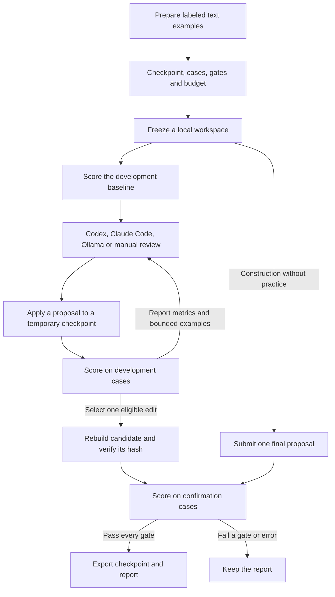

# AutoWeight architecture

Codex and Claude Code use the local MCP server. A terminal user can submit proposals through the CLI or let a local Ollama model propose them. Each path uses the same workspace runner. The proposer suggests tensor edits and the runner measures their effects before exporting a checkpoint. [CLI and MCP guide](06-cli-and-mcp.md)

## What the runner owns

- **Inputs and provenance.** `prepare` and MCP `prepare_evals` can validate preassigned text splits or split labeled examples while keeping related prompt families together. The workspace records the base checkpoint, case files, gates, runtime and attempt budget. External runs also record the evaluator script and environment. [Evaluation preparation](06-cli-and-mcp.md#prepare-labeled-evaluation-data)
- **Tensor operations.** The CLI and MCP can list stored tensors and read bounded slices. Built-in repair supports restore, blend and scale. Versioned replacement proposals carry a hash-checked NPZ payload for replacing a whole tensor or a named slice. The runner checks shapes, values, overlap and size limits as it builds the candidate. [Patch contract](04-patch-contract.md)
- **Evaluation.** Built-in evaluators score text or tokens. External evaluators run as trusted local subprocesses with their own dependencies and return numeric observations for the specified cases and seeds. Repair gates use paired changes and optional score floors. Construction uses absolute target floors. The runner can reuse development baseline measurements across trials. [External evaluator protocol](15-external-evaluators.md) · [Evaluation protocol](05-evaluation-protocol.md)
- **Confirmation and export.** A workspace lock serializes writes and the runner reserves confirmation before inference starts. For repair, it rebuilds the selected candidate and checks that its hash matches the development candidate. It scores the serialized artifact and verifies the hash again before publishing. A passing run writes the report and an NPZ or Hugging Face model directory. Confirmation reports contain aggregate metrics. Use `verify` or MCP `get_run` to check the run and find the export.

The weight inspection examples also work outside this loop. They stage published tensors under opaque names and score a submitted diagnosis against a reference key. The simulator and Qwen replays use the runner's external evaluator path. [Weight-space examples](../examples/weight-space/README.md)
