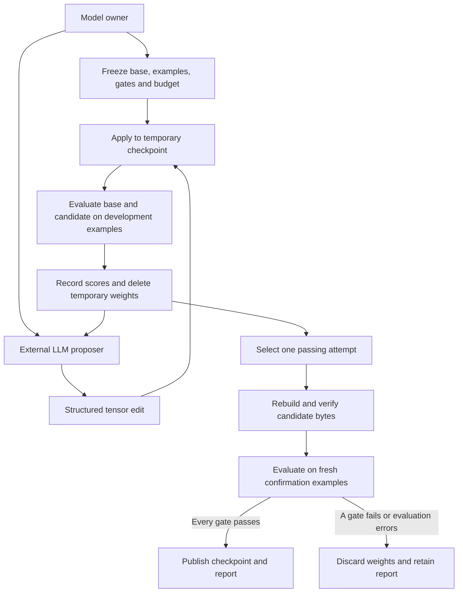

# Architecture

The CLI owns the workspace, freezes input hashes and runs one supervised evaluator process at a time. The worker selects an adapter from the frozen issue. It applies the declarative operations and scores both checkpoints with the same token or text evaluator. The Hugging Face adapter carries the original tokenizer and inference configuration into the export. It evaluates the candidate from the serialized file so the export contains the evaluated bytes.

The runner reserves confirmation before starting inference. Result directories become visible by rename once complete. An interrupted reservation consumes its slot. A workspace lock serializes operations and prevents two callers from publishing competing results.
